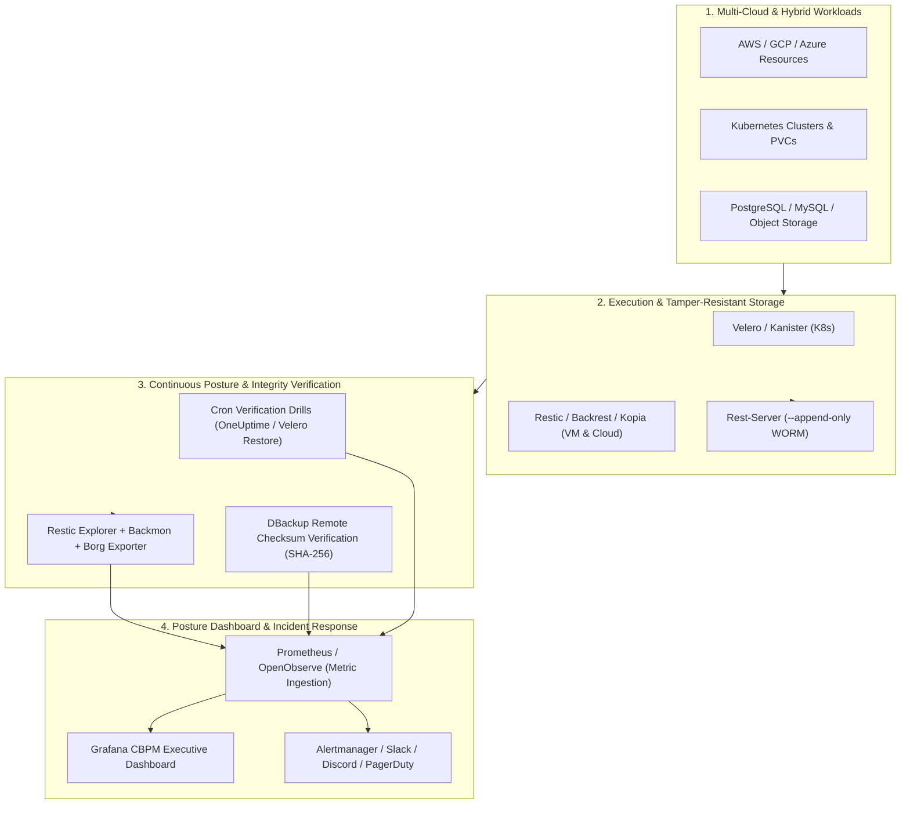

  

# 🛡️ Awesome Cloud Backup Posture Management (CBPM) ☁️

### *The Comprehensive Landscape of Cloud Backup Governance, Continuous Coverage Discovery, Immutability Audit & Ransomware Resilience*

---

## 📖 Introduction & Philosophy 🧭

This repository is an SEO-optimized, community-curated directory tracking enterprise **SaaS platforms** and **open-source GitHub projects** in **Cloud Backup Posture Management (CBPM)** and **Data Resilience Posture Management (DRPM)**. 

### Why Cloud Backup Posture Management Matters 🎯
Traditional backup workflows rely on static schedules and manual checklists. As organizations scale across multi-cloud infrastructure (AWS, Azure, Google Cloud), containerized environments (Kubernetes, OpenShift), and SaaS suites (Microsoft 365, Google Workspace, Salesforce), critical coverage gaps inevitably emerge:
- **Unprotected Cloud Resources**: VMs, databases, and object storage buckets created without automated backup policies attached.
- **Ransomware Vulnerabilities**: Un-airgapped snapshots without Object Lock or WORM compliance policies.
- **Silent Backup Failures**: Backups that report successful execution without verifiable block movement or validated restore drills.
- **Recovery Readiness Deficits**: Untested recovery runbooks where the target compute and network topology are missing during an outage.

CBPM turns cloud data protection into a **continuously verified, automated system** that autonomously scans cloud resources, maps backup coverage against regulatory frameworks (NIST, CIS, ISO 27001, HIPAA, NIS2), enforces retention rules, and verifies restore integrity.

---

## 📑 Table of Contents 📌

- [📊 Sector Overview & Market Dynamics](#-sector-overview--market-dynamics)
- [🏢 SaaS / Hosted Platforms](#-saas--hosted-platforms)
- [💻 Open-Source GitHub Projects](#-open-source-github-projects)
- [🛠️ Architectural Blueprint: Custom Self-Hosted CBPM](#-architectural-blueprint-custom-self-hosted-cbpm)
- [🤝 How to Contribute](#-how-to-contribute)
- [☕ Support & Sponsorship](#-support--sponsorship)
- [📈 Star History](#-star-history)
- [⚠️ Disclaimer & Operational Realities](#-disclaimer--operational-realities)

---

## 📊 Sector Overview & Market Dynamics 📈

The global cloud backup and data protection market is estimated at **$7.13B–$8.73B in 2026** (projected to exceed **$25B–$30B by 2032** at a 16–22% CAGR), with the emerging Cloud Backup Posture Management (CBPM) segment gaining rapid momentum within the broader $9B+ Cloud Security Posture Management (CSPM) landscape. 

The sector is **moderately fragmented and rapidly consolidating**, characterized by established enterprise giants (Veeam, Rubrik, Cohesity, Commvault) executing major M&A (e.g., Commvault acquiring Clumio, Cohesity combining with Veritas's enterprise data protection business) alongside fast-growing venture-backed challengers (Eon, Keepit) disrupting legacy snapshots with autonomous, query-driven posture governance and data-lake activation.

---

## 🏢 SaaS / Hosted Platforms 🌐

*Sorted descending by company scale (enterprise valuation / revenue).*

| Platform | 🏢 Company Scale (Valuation / Revenue) | 💰 Starting Pricing Tier | 🎁 Free Tier / Trial Limits | 🚀 Key Capabilities & Posture Highlights |
| :--- | :--- | :--- | :--- | :--- |
| **[Rubrik](https://www.rubrik.com/)** | **~$22B–$23B** Market Cap / **$1.09B+** ARR (FY2025) | Starts at **~$130–$228/FETB/mo** (or ~$50,000/yr baseline contract; Enterprise quotes via Private Offer) | **Proof of Concept (PoC) / Guided Sandbox**: 30-day dedicated evaluation sandbox in enterprise environment (no unassisted free tier) | Zero Trust data security platform with immutable backups, ransomware anomaly detection, and automated recovery via Rubrik Security Cloud across enterprise, cloud, and SaaS. |
| **[Veeam](https://www.veeam.com/)** | **~$15B** Valuation (2024 secondary) / **$1.75B+** ARR | Starts at **$1.08/user/mo** (Entra ID), **$3.33/user/mo** (M365 Backup), or **~$155–$250/workload/yr** (VUL Foundation) | **Free Forever**: Veeam Community Edition protects up to **10 workloads** indefinitely. **Free Trial**: 30-day enterprise trial (falls back to Community Edition) / 14-day SaaS trial. | Broadest workload coverage across virtual (VMware/Proxmox), cloud (AWS/Azure/GCP), and SaaS with granular restore and metadata protection. |
| **[Cohesity](https://www.cohesity.com/)** | **~$7B** Valuation / **$1.6B+** Combined Revenue (with Veritas) | Starts at **~$29,100/yr** (10 BETB DataProtect as a Service on AWS Marketplace baseline, ~$242.50/BETB/mo) | **Free Trial**: 30-day free trial of Cohesity Cloud Services (DataProtect as a Service) with full sandbox testing (no permanent free tier). | Data security and management platform with backup, disaster recovery, threat intelligence, and Helios posture visibility. |
| **[Commvault Cloud](https://www.commvault.com/)** | **~$5.5B–$6.5B** Market Cap / **$1.03B+** ARR (FY2025) | Starts at **$1.70/user/mo** (Standard M365) to **$3.60/user/mo** (Enterprise M365); FETB consumption available | **Free Trial**: 30-day full-feature trial (no credit card required) or 30,000 AWS/Azure Marketplace trial credits over 30 days. | Enterprise data protection platform featuring Cloud Cleanroom Recovery for cyber recovery testing and ThreatWise proactive cyber deception. |
| **[Eon](https://www.eon.io/)** | **$4B** Valuation (Series D) / **$500M** Raised | Starts at **~$0.01–$0.025/GB/mo** (consumption-based via AWS/GCP Marketplace contracts; custom capacity commitments) | **Free Tier**: "Free for builders" developer access tier. **Free Trial**: 14-to-30 day cloud marketplace evaluation (infrastructure costs excluded). | Autonomous Cloud Backup Posture Management (CBPM) platform scanning and classifying cloud resources continuously, queryable backup data lakes, and automated recovery without full VM provisioning. |
| **[Druva](https://www.druva.com/)** | **~$2B+** Valuation / **$250M+** ARR | Starts at **$4.00–$8.00/user/mo** (inSync SaaS/Endpoints) or ~$200–$250/TB/mo consumption for cloud workloads | **Free Trial**: 30-day full-feature trial for Microsoft 365, endpoints, and cloud workloads with live chat support and AI guidance (no credit card required). | 100% SaaS-based data protection and posture management with global deduplication, endpoint protection, and automated ransomware resilience. |
| **[Metallic (Commvault)](https://www.metallic.io/)** | Part of **Commvault ($5.5B–$6.5B)** | Starts at **$1.70/user/mo** (M365 Backup standard) up to **$4.50/user/mo** (M365 Compliance tier) | **Free Trial**: 30-day free trial across M365, endpoints, and VM backup workloads (no credit card required). | SaaS-delivered backup and recovery under the Commvault Cloud portfolio, providing subscription data protection for M365, Salesforce, and endpoints. |
| **[Clumio (Commvault)](https://www.clumio.com/)** | Acquired by **Commvault** (2024) | Starts at **$0.010/GiB/mo** (Archive tier) & **$0.025/GiB/mo** (Standard tier) + $1.50/M managed objects | **Free Trial**: 14-day free trial on AWS and GCP Marketplaces (includes instant access snapshot restores and DynamoDB/S3 protection). | AWS-native serverless data protection and posture management with instant access search and granular recovery for S3, EBS, and DynamoDB. |
| **[Keepit](https://www.keepit.com/)** | **~$172M+** Raised / Private | Starts at **$2.60–$4.95/user/mo** (or £4.00/user/mo on UK G-Cloud; includes unlimited storage & retention) | **Free Trial**: 30-day enterprise evaluation trial for Microsoft 365, Google Workspace, and Salesforce (no permanent free tier). | Dedicated vendor-independent cloud-to-cloud backup with tamper-proof immutable data storage and 10-year retention guarantee. |
| **[HYCU](https://www.hycu.com/)** | **~$140M+** Raised / Private | Starts at **$1.20/user/mo** (Identity/Okta), **$2.25/user/mo** (M365), or **$5,000/yr** (Starter Bundle: 50 VMs, 10 TB, 100 SaaS users) | **Free Trial**: 14-day free trial for HYCU R-Cloud and cloud-native Azure/AWS data protection. | Multi-cloud backup for Nutanix, VMware, and R-Cloud integration covering 70+ SaaS applications and identity suites. |

---

## 💻 Open-Source GitHub Projects 🔓

*Open-source platforms, engines, verification runbooks, and posture exporters. Ranked and sorted descending by GitHub Stars_Count.*

| Project | ⭐ Stars_Badge | 🏷️ License | 🎯 Category / Primary Focus | 🔍 Posture & Verification Highlights |
| :--- | :--- | :--- | :--- | :--- |
| **[Grafana](https://github.com/grafana/grafana)** |  | AGPL-3.0 | Observability & Visualization Platform | Universal visualization and alerting engine used across DevOps and SRE teams to aggregate metrics from Restic Explorer, Backmon, Velero, and Prometheus Borg exporters into single-pane-of-glass CBPM dashboards. |
| **[Restic](https://github.com/restic/restic)** |  | BSD-2-Clause | Deduplicating Secure Backup Engine | Fast, secure, cryptographically verifiable backup engine supporting local, S3, Azure Blob, GCS, B2, and SFTP with integrated `restic check --read-data` cryptographic block verification. |
| **[OpenObserve](https://github.com/openobserve/openobserve)** |  | AGPL-3.0 | Cloud-Native Observability | High-throughput, cloud-native storage engine for logs, metrics, and traces that ingests backup health signals, audit logs, and retention breach alerts across multi-cloud environments. |
| **[Duplicati](https://github.com/duplicati/duplicati)** |  | LGPL-2.1 | Encrypted Cloud Backup Client | Block-based encrypted backup client supporting S3, Azure, OneDrive, Google Drive, and Mega with built-in remote database verification and automated repair routines. |
| **[Kopia](https://github.com/kopia/kopia)** |  | Apache-2.0 | Fast Encrypted Deduplicating Backup | Next-generation fast backup tool with client-side zero-knowledge encryption, content-addressable deduplication, snapshot management, policy-driven retention enforcement, and verification commands. |
| **[BorgBackup](https://github.com/borgbackup/borg)** |  | BSD-3-Clause | Deduplicating Archiver | Battle-tested authenticated encryption backup tool with deduplication, compression, and robust snapshot integrity checks (`borg check`). |
| **[Velero](https://github.com/vmware-tanzu/velero)** |  | Apache-2.0 | Kubernetes DR & Cluster Migration | Standard for Kubernetes cluster backup and disaster recovery. Captures cluster resources and persistent volumes across cloud providers with schedule policies and Prometheus metrics. |
| **[CloudNativePG](https://github.com/cloudnative-pg/cloudnative-pg)** |  | Apache-2.0 | Kubernetes PostgreSQL Posture & DR | Kubernetes operator managing enterprise PostgreSQL with automated continuous WAL archiving, Barman-backed object storage backup, automated recovery point testing, and health status indicators. |
| **[OneUptime](https://github.com/OneUptime/oneuptime)** |  | Apache-2.0 | Open-Source Observability & DR | All-in-one open-source observability suite maintaining published runbooks and automated CronJobs for Velero end-to-end restore verification and Rook-Ceph disaster recovery testing. |
| **[Backrest](https://github.com/garethgeorge/backrest)** |  | GPL-3.0 | Web UI & Orchestrator for Restic | Fully featured Web UI and orchestrator wrapping Restic with automated scheduling, continuous repo health checks, plan tracking, Discord/Slack webhooks, and multi-repo visibility. |
| **[Pulse](https://github.com/rcourtman/pulse)** |  | MIT | Proxmox VE / PBS Posture Dashboard | Purpose-built real-time monitoring dashboard for Proxmox VE, Proxmox Backup Server (PBS), and Docker infrastructure with interactive Backup Explorer, cross-highlighted grid, and smart alerts. |
| **[Zabbix](https://github.com/zabbix/zabbix)** |  | GPL-2.0 | Enterprise Infrastructure Monitoring | Enterprise monitoring suite featuring native AWS Backup templates for vault discovery, recovery point tracking, retention audit, and AWS Backup Vault Lock verification. |
| **[Vorta](https://github.com/borgbase/vorta)** |  | GPL-3.0 | Desktop GUI for BorgBackup | Graphical backup client integrating BorgBackup with scheduled background profiles, snapshot diff visualization, and repository integrity check verification. |
| **[Borgmatic](https://github.com/borgmatic-collective/borgmatic)** |  | GPL-3.0 | Declarative Backup Orchestrator | Declarative configuration wrapper for BorgBackup that automates database dumps, snapshot creation, consistency checks, remote monitoring pings, and retention pruning. |
| **[Autorestic](https://github.com/cupcakearmy/autorestic)** |  | Apache-2.0 | CLI Wrapper for Restic | Config-driven orchestrator for Restic supporting multi-location backups, automatic prune/check schedules, and health hooks. |
| **[Rest Server](https://github.com/restic/rest-server)** |  | BSD-2-Clause | Secure Append-Only Restic Server | High-performance HTTP server for Restic repositories with `--append-only` mode, providing tamper-resistant ransomware defense by preventing deletion of existing snapshots. |
| **[Kanister](https://github.com/kanisterio/kanister)** |  | Apache-2.0 | Application-Consistent Kubernetes DR | Extensible framework for application-level data management on Kubernetes, orchestrating consistent database backups (MySQL, PostgreSQL, MongoDB) with automated validation blueprints. |
| **[DBackup](https://github.com/Skyfay/DBackup)** |  | GPL-3.0 | Backup Integrity & Storage Explorer | Automated backup solution featuring native checksum verification for S3/R2/Hetzner (SHA-256 via metadata), Google Drive (MD5), and OneDrive without downloading files. |
| **[Bacula-Web](https://github.com/bacula-web/bacula-web)** |  | GPL-2.0 | Bacula Reporting & Analytics | Reporting and health monitoring interface for Bacula backup infrastructure, exposing job status, pool volume metrics, and catalog health. |
| **[Restic Explorer](https://github.com/tmseidel/restic-explorer)** |  | MIT | Restic Repository Health Dashboard | Observability-first health dashboard for restic repositories (`/actuator/health`), multi-repo status badges, automated integrity scans, and retention policy breach alerting. |
| **[Prometheus Borg Exporter](https://github.com/mad-ady/prometheus-borg-exporter)** |  | MIT | Borg Prometheus Exporter | Lightweight exporter parsing Borg repository archives, snapshot durations, and sizes as Prometheus metrics for posture alerting. |
| **[Backmon](https://github.com/dreitier/backmon)** |  | MIT | File & Object Storage Backup Watchdog | Go-based monitor evaluating presence, size, and timestamp freshness of recurring backups in local filesystems and S3/MinIO buckets with Prometheus integration. |
| **[BackupBeacon](https://wordpress.org/plugins/backupbeacon/)** |  | GPL-2.0 | Independent Backup Freshness Watchdog | Zero-dependency webhook check-in watchdog monitoring backup heartbeat timestamps and alerting on stale or silent backup tasks. |
| **[jobwatch](https://www.npmjs.com/package/jobwatch)** |  | MIT | Cron & Backup Check-In CLI | Dead-man's switch watchdog CLI for scheduled backup scripts, evaluating `OK`, `OVERDUE`, and `NEVER` health states with standard exit codes. |

---

## 🛠️ Architectural Blueprint: Custom Self-Hosted CBPM 🏗️

Organizations seeking a completely vendor-independent, open-source Cloud Backup Posture Management pipeline can compose an enterprise-grade stack using these components:

---

## 🤝 How to Contribute 💡

Contributions from platform engineers, security researchers, SREs, and backup admins are welcome!

1. 🍴 **Fork the repo** to your personal GitHub account.
2. 🌿 **Create a descriptive branch**: `git checkout -b add-my-backup-tool`.
3. 📝 **Add or update entries** in `README.md` following the exact table structure. Ensure SaaS entries include specific pricing and free tier/trial limits, and open-source tools include their Stars_Badges and repository links.
4. 🔍 **Verify links** and make sure factual information is verifiable.
5. 🚀 **Submit a Pull Request** with a concise summary of the addition.

---

## ☕ Support & Sponsorship 💖

If this curated repository saved you hours of research or helped you strengthen your organization's backup posture:

- ⭐ **Star this repository** to help others discover it!
- 🍴 **Fork and share** with your DevOps, SRE, and platform engineering teams.
- ☕ **Sponsor the maintainer** or buy a coffee via the [GitHub Sponsor Dashboard](https://github.com/sponoors/ishandutta2007) to support continuous open-source research and updates!

---

## 📈 Star History 🌟

---

## ⚠️ Disclaimer & Operational Realities 🚨

- **Community-Curated**: This repository is a curated community guide and does not constitute a formal commercial endorsement.
- **Untested Backups Are Schrodinger's Data**: A backup whose recovery has never been tested is only a theoretical backup. Always implement automated restore drills that verify byte movement and service startup, rather than trusting a "Job Completed" status badge.
- **Declared State vs. Stored State**: GitOps declarations rebuild container specifications, but they do not restore persistent data volumes. Align your GitOps and data backup policies simultaneously.
- **Ransomware Defense**: Ensure your offsite repositories implement hardware-enforced immutability (AWS S3 Object Lock, Azure Immutable Blob, or append-only REST backends) to prevent malicious encryption of backup pools.
- **Compliance & Security**: Secure all backup metadata, encryption keys (KMS), and transit pipelines with AES-256-GCM and strict IAM least-privilege principles.

---

  Maintained with ❤️ by <a href="https://github.com/ishandutta2007">Ishan Dutta</a> and the Cloud Engineering Community.

